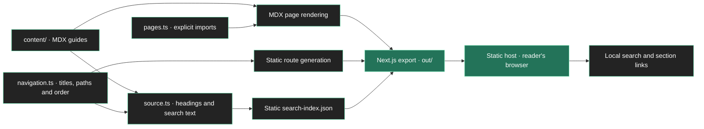

<div align="center">
  
  <h1>Wrenai Documentation</h1>
  <p><strong>Private AI for your DeFi</strong></p>
  <p>Guides to private research, payments and trading agents.</p>
  <p>
    <a href="https://docs.wrenai.xyz"></a>
    <a href="https://app.wrenai.xyz"></a>
    <a href="../README.md"></a>
  </p>
  <p><a href="#content-model">Content model</a> · <a href="#setup">Setup</a> · <a href="#add-or-update-a-guide">Writing guides</a> · <a href="#deployment">Deployment</a></p>
</div>

---

[docs.wrenai.xyz](https://docs.wrenai.xyz) explains private AI, agent setups, trading and privacy controls. This package is a **static Next.js and MDX site**; trading runs in the [Wrenai application](../Wrenai/README.md).

[Repository overview](../README.md) · [Application README](../Wrenai/README.md) · [Landing page README](../LandingPage/README.md)

## Content model

Guides live in [`content/`](content/) and are grouped into Get started, Jarvis, Agents, Trading, Security and privacy, and Reference. Page titles, descriptions and reading order live in [`src/docs/navigation.ts`](src/docs/navigation.ts). MDX imports are explicitly registered in [`src/docs/pages.ts`](src/docs/pages.ts).

The site includes sidebar navigation, mobile navigation, heading anchors, a table of contents, previous/next navigation, copyable code blocks and client-side search. The presentation is custom; it does not depend on a hosted documentation platform.



Search records are generated from source at build time. The search dialog fetches `/search-index.json` on first use and searches in the browser; it does not send queries to an external search service.

## Setup

Requires **Node.js 24.22.1+** and **pnpm 11.24.0**. From `DocsSite/`:

```sh
pnpm install --frozen-lockfile
```

Environment configuration is optional. To override app destinations, copy [`.env.example`](.env.example) to `.env` and set:

```dotenv
NEXT_PUBLIC_APP_URL=https://app.wrenai.xyz
```

[`src/app-url.ts`](src/app-url.ts) resolves this public value during the build. Production builds require HTTPS; local development may use `http://localhost:3000`. No Supabase, Redis, inference or signing credentials belong here.

## Commands

| Command | Purpose |
| --- | --- |
| `pnpm dev` | User-run documentation server on port 3002. |
| `pnpm typecheck` | Generate route types and check TypeScript. |
| `pnpm lint` | Run Biome. |
| `pnpm build` | Export documentation and the search index to `out/`. |

This package has no separate test script. Tests of product behavior remain in `Wrenai/tests/`.

## Add or update a guide

1. Write or edit the MDX file under the appropriate `content/` group. The page wrapper supplies the title; use `##` and `###` for sections.
2. For a new page, add its path, file key, title and description to `src/docs/navigation.ts`.
3. Add the matching explicit MDX import to `src/docs/pages.ts`. An unregistered file does not automatically become a route.
4. Use the shared components from [`src/mdx-components.tsx`](src/mdx-components.tsx): `Callout`, `Card`, `Cards`, `Step` and `Steps`.
5. Check internal links against registered paths. Update neighboring guides when a changed flow affects their instructions.
6. Run the relevant checks, then have the operator build the static export before publishing.

`/` renders the introduction. Other registered pages are generated by [`src/app/[...slug]/page.tsx`](src/app/[...slug]/page.tsx); unknown paths return a 404. Headings and search text are extracted by [`src/docs/source.ts`](src/docs/source.ts).

## Editorial contract

- Describe the current implementation, using the same labels and actions as the app.
- Give users a concrete action and an observable outcome. Name essential prerequisites before the action.
- Keep testnet and mainnet instructions distinct. Tidepool is an independent public sandbox, not an official confidential Intents testnet.
- Distinguish a quote, a submitted order and a confirmed result. Do not imply that a preview moved funds.
- Explain that NEAR AI verification establishes response provenance, not investment accuracy or guaranteed profits.
- State that backend signing keys and chats are encrypted in storage, while the backend can decrypt them during processing. Do not claim operator-private execution.
- Document public deposits, wallet payouts, RHEA, Hyperliquid and testnet activity as public.
- Keep agent capabilities, token support, provider names and setup steps aligned with source rather than expanding a roadmap into a feature claim.

The [hackathon brief](https://near.army/HACKATHON.md) is an external reference for submission requirements. Product documentation should remain useful beyond the event; submission instructions and project architecture belong in the root README.

## Deployment

Use `DocsSite` as its own hosting project root. Install from the pinned lockfile, run `pnpm build`, and serve `out/`. The configuration in [`next.config.ts`](next.config.ts) uses static export; it needs no long-running application server or database. Configure security headers at the static host.

Deploy content, navigation, loaders and the generated search index together. Rebuild after changing app destinations or guides; the site has no runtime content database.
