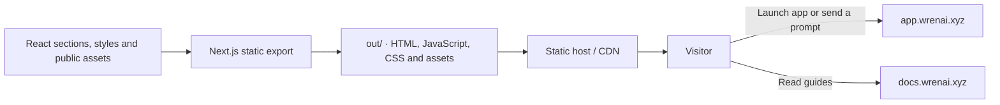

# Wrenai landing page

The public introduction to Wrenai at [www.wrenai.xyz](https://www.wrenai.xyz): a product site that explains the NEAR trading desk, demonstrates its workflows and leads visitors into the app.

This directory is an independent **static Next.js application**. It presents the product; authentication, live research, balances, signing and settlement belong to the [Wrenai application](../Wrenai/README.md).

[Repository overview](../README.md) · [Application README](../Wrenai/README.md) · [DocsSite README](../DocsSite/README.md)

## What it contains

- A Jarvis hero with example prompts and links into the real chat.
- Product features and visual explanations of research, execution and privacy.
- An interactive walkthrough of the seven agent families.
- Ecosystem integrations, FAQ, theme switching and accessible reduced-motion behavior.
- [`public/WRENAI.md`](public/WRENAI.md), the public product guide for external AI assistants, served at `/WRENAI.md`.
- Vercel Web Analytics for landing-page usage.

The on-page examples and animated flows illustrate behavior. They are not live balances, executable orders or settlement evidence.

## Delivery model



The site exports static files through [`next.config.ts`](next.config.ts). It has no trading backend, database connection or private environment variables. GSAP handles visual sequences, Lenis handles scroll behavior, and React Flow powers workflow diagrams.

## Setup

Requires **Node.js 24.22.1+** and **pnpm 11.24.0**. Run these commands from `LandingPage/`:

```sh
pnpm install --frozen-lockfile
```

No environment configuration is required for the production app links. To change their destination, copy [`.env.example`](.env.example) to `.env` and set:

```dotenv
NEXT_PUBLIC_APP_URL=https://app.wrenai.xyz
```

This value is public and resolved at build time by [`src/app-url.ts`](src/app-url.ts). Production builds require an HTTPS destination. Local development can point it at `http://localhost:3000`. Documentation links use `https://docs.wrenai.xyz`.

## Commands

| Command | Purpose |
| --- | --- |
| `pnpm dev` | User-run development server on port 3001. |
| `pnpm typecheck` | Generate route types and check TypeScript. |
| `pnpm lint` | Run Biome. |
| `pnpm build` | Export the site to `out/`. |

This package has no separate test script. Runtime and execution tests belong to the application package.

## Editing guide

| Path | Responsibility |
| --- | --- |
| `src/app/page.tsx` | Section order and page composition. |
| `src/app/layout.tsx` | Fonts, metadata, theme initialization, smooth scrolling and analytics. |
| `src/app/*.css` | Theme tokens and section styling. |
| `src/components/hero/` | Jarvis examples, prompt entry and hero visuals. |
| `src/components/sections/` | Features, agents, workflows, privacy, integrations and FAQ. |
| `src/components/agents/`, `flows/`, `privacy/` | Interactive product explanations. |
| `src/components/motion/` | Animation setup and reduced-motion handling. |
| `src/app-url.ts` | App destinations and documentation URL. |
| `public/` | Brand assets, theme bootstrap and the public AI-assistant guide. |

Keep public copy aligned with actual application behavior: exactly seven agent families, five compatible guest-testnet types, explicit public execution routes and the real backend privacy boundary. Update the public assistant guide when supported instructions or deep links change. Never put credentials, customer data or trading logic in this package.

## Deployment

Use `LandingPage` as an independent hosting project root. Install with the pinned lockfile, build with `pnpm build`, and serve `out/`. Vercel can host the static export; other static hosts need equivalent asset routing and security headers. Vercel Web Analytics requires enabling Analytics on that hosting project.

The deployed app and documentation must be reachable separately. Changing a destination requires rebuilding the landing page because links are baked into the export.
