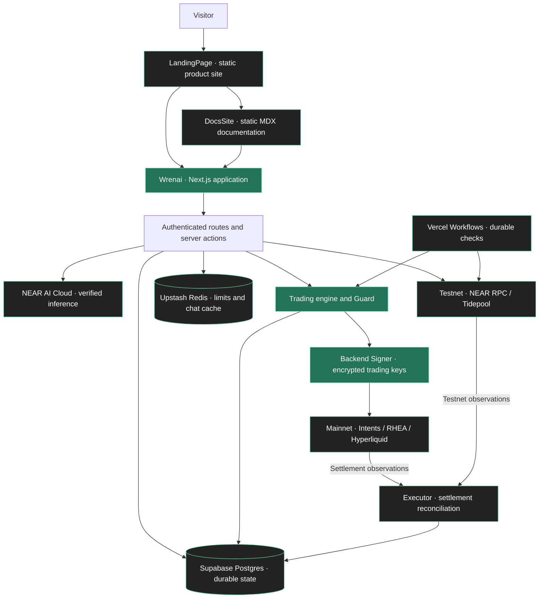
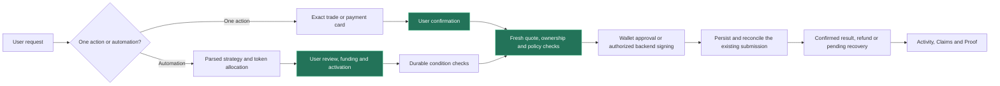

  
  <h1>Wrenai</h1>
  
<strong>Private AI for your DeFi</strong>

  
Private research and agentic trading on NEAR.

  

    
    
    
    
  

  

    <a href="#screenshots">Screenshots</a> ·
    <a href="#what-you-can-do">Capabilities</a> ·
    <a href="#architecture">Architecture</a> ·
    <a href="#repository-guide">Developer guides</a>
  

---

Wrenai brings **private AI and agentic trading to NEAR**. Research markets with Jarvis, automate your trading rules, or confirm a swap or payment in chat.

Research uses verified models on **NEAR AI Cloud**. Supported confidential swaps and payments run through **NEAR Intents**. [See the privacy boundary](#privacy-and-control).

## Screenshots

<table>
  <tr>
    <td width="50%" align="center">
      <h3>Portfolio</h3>
      
Wallet assets, allocations and agent activity.

      <!-- Replace the placeholder below with a real Portfolio screenshot. -->
        <em>Portfolio screenshot</em>   
    </td>
    <td width="50%" align="center">
      <h3>Jarvis</h3>
      
Market research and exact trade or payment cards.

      <!-- Replace the placeholder below with a real Jarvis screenshot. -->
        <em>Jarvis screenshot</em>   
    </td>
  </tr>
  <tr>
    <td width="50%" align="center">
      <h3>Agent workspace</h3>
      
Reviewed instructions, live conditions and execution progress.

      <!-- Replace the placeholder below with a real agent screenshot. -->
        <em>Agent screenshot</em>   
    </td>
    <td width="50%" align="center">
      <h3>Markets</h3>
      
Spot, perpetuals and NEAR token discovery.

      <!-- Replace the placeholder below with a real markets screenshot. -->
        <em>Markets screenshot</em>   
    </td>
  </tr>
</table>

---

## What you can do

- **Private AI research.** Ask Jarvis about markets, chart indicators and news using verified NEAR AI Cloud models.
- **Agentic trading.** Describe your entries, schedules and exits. Review the rules, fund the agent and let it monitor and trade while you are offline.
- **Swaps and payments.** Confirm an exact quote or payment in chat, without creating an agent.
- **Confidential routes.** Use supported private Intents swaps and payments. Wallet transfers, RHEA, Hyperliquid and testnet activity remain public.
- **Visible results.** Follow balances, orders and agent activity; inspect receipts and claim remaining funds.

### Seven focused agents

| Agent | Purpose |
| --- | --- |
| Private Payments | Send an exact amount to a specified recipient using a supported confidential route or an explicitly public payout. |
| DCA | Purchase a specified asset on a defined schedule, with bounded spending and expiry. |
| Spot Trader | Buy or sell an exact pair, with supported entry conditions and protective exits. |
| Perps | Trade Hyperliquid markets with reviewed size, leverage, take-profit, stop-loss and trailing rules. |
| Meme Hunter | Discover NEAR launches, evaluate token and liquidity evidence, and trade eligible routes. |
| Buy the Dip | Buy when a specified price or drawdown condition is met. |
| Sell the Top | Exit owned inventory at defined profit targets, using known cost basis rather than claiming to predict a market top. |

Agents execute reviewed rules. Model-generated prose does not sign orders or silently change a strategy. Token eligibility depends on the actual route, balance location, liquidity and venue limits.

## Why NEAR

NEAR supplies the account, inference and settlement primitives that make this desk possible:

| Building block | Role in Wrenai |
| --- | --- |
| NEAR accounts and NEP-413 | Wallet ownership verification through NEAR Connect, without a sign-in transaction. |
| NEAR AI Cloud | Encrypted inference with model attestation and response-signature verification for research and strategy interpretation. |
| NEAR Intents and 1Click | Supported cross-chain quotes, confidential swaps and payments, funding and payouts. |
| RHEA Finance | Public NEAR execution for supported pairs, including routes that deliver native NEAR, plus pool data. |
| NEAR token discovery and RPC | Discover wallet assets, verify token metadata and balances, and reconcile finalized transactions. |
| Tidepool on NEAR testnet | A separate public sandbox for supported test-token swaps and Intents balances. |

## Architecture

The repository contains three independently deployed applications. The trading backend lives inside `Wrenai`; the landing page and documentation do not hold trading credentials.

Postgres is the financial authority: reservations, strategy revisions, orders, fills and recovery state live there. Redis accelerates requests and recent encrypted chat history; it cannot approve spending. Mainnet and testnet share the configured database but use separate testnet tables and a separate migration journal.

### From instruction to settlement

Scheduled checks use Vercel Workflows rather than Cron. Timing is best effort; a timeout is reconciled against the existing order instead of treated as permission to submit another one.

## Demo

Follow this walkthrough in the [live app](https://app.wrenai.xyz). Guest mode uses test tokens and requires no wallet connection.

### Without a wallet

On a configured deployment, open the [app](https://app.wrenai.xyz) and choose **Try as a guest**. The shared testnet pool allocates **0.1 test NEAR, 5 test USDC and 5 test USDT** per guest, subject to pool availability and usage caps.

| Do this | What to inspect |
| --- | --- |
| Open Portfolio after entering as a guest. | Your allocation and the NEAR Testnet badge, in the same app layout. |
| Ask Jarvis: `Quote 0.5 USDC to USDT.` | A testnet quote for supported Tidepool tokens; review the balance location before confirming. |
| Confirm the card. | Submission progress, the settled balance change and an Activity record. |
| Create a DCA agent: `Spend 0.5 USDC to buy USDT every 60 seconds for 2 purchases.` | Review the parsed schedule and 1 USDC allocation; deploy and inspect the agent timeline. |
| Stop the agent and open Claims. | Funds still assigned to the stopped agent, with an explicit claim action. |

The testnet catalog contains Payments, Spot Trader, DCA, Buy the Dip and Sell the Top. Payments are public. Swaps use Tidepool's supported test tokens; native NEAR is available for payments, not Tidepool swaps. Perps, Meme Hunter and confidential routes remain mainnet-only. Connected testnet wallets can make wallet-approved manual transactions; autonomous testnet agents use guest allocations.

Tidepool is an independent sandbox, **not an official 1Click testnet**. The [hackathon brief](https://near.army/HACKATHON.md) describes the production Intents integration as mainnet-only. Testnet results do not establish mainnet liquidity, privacy or execution readiness.

### With a NEAR wallet

Connect a mainnet wallet and sign the ownership message. Research, inspect balances and request quotes before moving funds. Manual orders require an exact card confirmation. Agents can be created before trading access is configured; execution requires the relevant authorization, recovery setup and funding.

Mainnet transactions use real assets. The source includes execution adapters, but deployment configuration and live acceptance must be checked for the particular route being used. No blanket claim of production certification or guaranteed returns is made.

## Privacy and control

| Boundary | What the implementation provides |
| --- | --- |
| Model inference | NEAR AI Cloud TEE evidence and response verification; streamed text remains provisional until verified. |
| Private Intents routes | Confidential activity within the provider's supported environment. Deposits and public payouts expose their public-chain legs. |
| Public execution | Wallet transfers, RHEA swaps, Hyperliquid activity and testnet transactions are public. |
| Stored data | Chats and signing material are encrypted at rest. The Vercel backend can decrypt what it processes and the keys it uses to sign. |
| Spending authority | Exact per-agent token reservations, ownership checks, policy checks and revocable trading access. Unknown submissions retain their holds until reconciled. |

Wrenai does not claim operator-private signing. Verification establishes inference provenance, not the correctness of financial advice. A private request is never silently converted into a public payment.

## Repository guide

| Directory | Responsibility | Read next |
| --- | --- | --- |
| [`Wrenai/`](Wrenai/) | Product UI, authenticated backend, trading engine, storage and workflows. | [Application README](Wrenai/README.md) |
| [`LandingPage/`](LandingPage/) | Static product presentation and app entry points. | [Landing page README](LandingPage/README.md) |
| [`DocsSite/`](DocsSite/) | Static, searchable product documentation authored in MDX. | [Documentation site README](DocsSite/README.md) |

Each application has its own `package.json`, pinned dependencies, lockfile and deployment root. There is no root install or shared root build command. Use **Node.js 24.22.1 or newer** and **pnpm 11.24.0**, then follow the relevant README.

## Foundations and attribution

Wrenai uses Next.js, React, TypeScript and Tailwind CSS; NEAR Connect and NEAR JavaScript libraries; the NEAR AI inference SDK; the NEAR Intents 1Click SDK; Drizzle and `pg`; Vercel Workflows; Upstash Redis; TanStack Query; Radix UI, Motion, GSAP and Lenis; and MDX with remark-gfm. Exact dependency versions are recorded in each application's manifest and lockfile. Codex has been used for AI-assisted implementation and documentation.

External services include NEAR AI Cloud, NEAR Intents, RHEA, Hyperliquid, FastNear, Nearblocks, Squint, Nearly, Meme.Cooking, CoinGecko, Coinbase Exchange, Tavily, Tidepool, Vercel, Supabase and Upstash. Their responsibilities are described in the [application README](Wrenai/README.md) and [service reference](https://docs.wrenai.xyz/reference/services).

## License

Licensed under the [MIT License](LICENSE). Third-party libraries and assets retain their respective licenses and notices.
