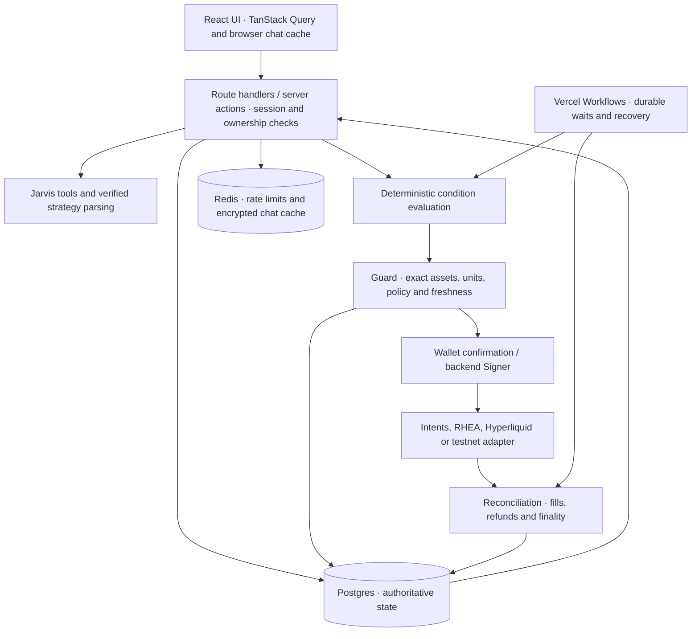

# Wrenai application

The product and execution service behind [app.wrenai.xyz](https://app.wrenai.xyz). This Next.js application contains the trading desk, Jarvis, wallet authentication, agent runtime, financial ledger and provider adapters.

For product positioning and the repository architecture, start with the [root README](../README.md). The [landing page](../LandingPage/README.md) and [documentation site](../DocsSite/README.md) are separate static applications.

## Product surfaces

| Surface | Responsibility |
| --- | --- |
| Portfolio | Wallet balances, available allocations, agent summaries and market context. |
| Agents | Use-case-specific setup, strategy templates, verified review, funding, controls and runtime progress for seven agent families. |
| Jarvis | Streaming research, wallet context, manual swap and payment cards, Perps previews and direct agent setup entry points. |
| Spot, Perps, Memecoins | Market discovery and manual trading; mainnet-only trading surfaces are labeled on testnet. |
| Activity | Wallet and agent events, with execution progress and transaction references. |
| Claims | Recoverable agent inventory and explicitly confirmed returns. |
| Proof | Stored inference-verification receipts and execution evidence, with the evidence type made explicit. |
| Settings | Trading authorization, recovery and account controls. |

Mainnet lives at `/`; testnet lives at `/testnet`. Both use the existing shell and components. Testnet exposes Payments, Spot Trader, DCA, Buy the Dip and Sell the Top; it does not enable Perps, Meme Hunter or confidential transfers.

## Runtime design



Manual confirmations bind to an exact reviewed action. Agents use a reviewed strategy revision and allocated inventory. Model output is parsed and validated before use; the model cannot bypass the Guard or access signing keys.

Financial state stays in Postgres. Token quantities use exact smallest-unit integers; assets are identified by their verified contract or route ID, not ticker alone. Native NEAR and wNEAR are distinct. Reservations account for other agents and unresolved orders; Redis is never spending authority.

Workflows persist progress and wait between checks instead of using Cron or a permanently running server process. Retries reconcile an existing submission before any new action. Pausing an agent prevents new orders while already submitted orders still require settlement tracking.

## Prerequisites

- Node.js **24.22.1+** and pnpm **11.24.0**.
- A managed Postgres database; the deployed setup uses Supabase.
- Upstash Redis REST credentials for shared request limits and chat caching.
- A NEAR AI Cloud API key for Jarvis and strategy interpretation.
- A funded, separate testnet pool and testnet encryption key for guest execution.
- The relevant wallet, provider access and recovery setup for mainnet execution.

Public data providers can fail or restrict access. A working page or dry quote does not certify that a funding or execution route is ready.

## Configuration

From this directory, copy [`.env.example`](.env.example) to `.env` and configure only server-side secrets there. The template is the complete configuration reference.

| Variable | Purpose |
| --- | --- |
| `APP_URL` | Exact public app origin. Used for signed ownership challenges and cookies; locally `http://localhost:3000`. |
| `DATABASE_URL` | Pooled Postgres connection URL with exactly one `sslmode=verify-full` parameter. |
| `KEY_ENCRYPTION_KEY` | Stable, independent 32-byte base64 master for mainnet signing material and domain-separated chat encryption. |
| `UPSTASH_REDIS_REST_URL`, `UPSTASH_REDIS_REST_TOKEN` | Distributed request limits and recent encrypted chat cache. Missing access blocks protected operations. |
| `NEAR_AI_API_KEY` | NEAR AI Cloud credential; accepts comma-separated keys. |
| `NEAR_RPC_URL` | Optional mainnet RPC override; defaults to FastNear. |
| `ONECLICK_JWT` | 1Click partner credential for the app's provider integration. |
| `TAVILY_API_KEY` | News and search enrichment for research. |
| `COINGECKO_API_KEY` | Spot-market metrics and icons. |
| `FASTNEAR_API_KEY` | Optional authenticated wallet-token discovery. |
| `DOCS_URL` | Documentation link; defaults to `https://docs.wrenai.xyz`. |
| `TESTNET_POOL_SEED` | Dedicated 32-byte Ed25519 seed in base64. The shared testnet account ID is derived from it. |
| `TESTNET_KEY_ENCRYPTION_KEY` | Separate, stable 32-byte base64 master for testnet data. |
| `WRENAI_LOCAL_EXECUTION` | Explicit opt-in for local mainnet agent execution. Leave unset for normal development. |

Generate each encryption master independently with `openssl rand -base64 32`, then keep it backed up and stable. Never reuse a mainnet seed for the guest pool. Changing encryption masters can make existing encrypted data unreadable.

For Supabase poolers, the URL also needs `sslrootcert=certs/supabase-root-2021.crt`. The public CA is included and traced into deployed functions. Keep passwords URL-encoded; never disable TLS verification to work around certificate errors.

Provider dashboards: [NEAR AI Cloud](https://cloud.near.ai), [NEAR Intents partners](https://partners.near-intents.org), [Supabase](https://supabase.com/dashboard), [Upstash](https://console.upstash.com), [Tavily](https://app.tavily.com), [CoinGecko](https://www.coingecko.com/en/api).

## Installation and database setup

These are operator-run commands from `Wrenai/`:

```sh
pnpm install --frozen-lockfile
cp .env.example .env
```

Fill in `.env` before applying migrations. Back up an existing database and review pending SQL first.

```sh
pnpm db:migrate
pnpm db:testnet:migrate
```

Mainnet migrations live in [`drizzle/postgres/`](drizzle/postgres/). Testnet migrations live in [`drizzle/testnet/`](drizzle/testnet/) and use a separate `drizzle_testnet` migration journal. Both use `DATABASE_URL`; testnet application tables are prefixed `testnet_`. Migrations are explicit release steps and never run inside a request.

The database is server-only: application tables use RLS and revoke public API-role access. The trusted backend still checks each session and resource owner. Do not configure browser-side Supabase access to bypass NEAR authentication.

## Testnet operation

The guest pool uses one operator-funded NEAR testnet account. Guests receive logical allocations tracked under their own owner records; they do not get control of the shared signing key.

Current policy in [`src/server/testnet/policy.ts`](src/server/testnet/policy.ts): **0.1 NEAR, 5 USDC and 5 USDT**, two-hour sessions, up to five agents and ten actions per session, with pool-wide daily limits. Per-action token caps and a native operations reserve also apply. Only unallocated, reconciled pool assets can back a new grant.

Guest signing uses the dedicated pool. Connected testnet wallets sign their own manual actions. Testnet encryption, sessions, orders, reservations and conversation records remain separate from mainnet records.

Tidepool supports wallet and public verifier balances for its listed test assets. Its verifier identity and quote key are pinned in [`src/server/testnet/provider.ts`](src/server/testnet/provider.ts). The adapter requires live provider pricing; fallback prices, changed verification pins or insufficient funds block new orders. Native NEAR payments are supported; Tidepool swaps require its listed fungible tokens. No automatic substitution of NEAR with wNEAR is allowed.

Use [Tidepool](https://www.usetidepool.tech) for its test-token faucet and [NEAR's testnet faucet](https://near-faucet.io) for test NEAR. Fund the account derived from the configured seed, in the balance locations the pool needs. Testnet's simplified rules and caps are not mainnet strategy acceptance.

## Commands

| Command | Purpose |
| --- | --- |
| `pnpm dev` | User-run development server on port 3000. |
| `pnpm typecheck` | Generate route types and run TypeScript checks. |
| `pnpm lint` | Enforce test placement and run Biome. |
| `pnpm test` | Run the Vitest suite. |
| `pnpm build` | Produce the production application and workflow output. |
| `pnpm start` | Serve an existing production build. |
| `pnpm db:generate` | Generate a reviewed mainnet schema migration. |
| `pnpm db:testnet:generate` | Generate a reviewed testnet schema migration. |
| `pnpm recover` | Run the offline trading-account recovery CLI; inspect its instructions before using recovery material. |

All tests, fixtures and test-only helpers belong under [`tests/`](tests/). Tests use provider mocks and in-process databases; they do not establish live financial acceptance. `db:import-sqlite` exists only for explicitly reviewed legacy imports. The application runtime uses Postgres, not SQLite.

## Deployment

Use `Wrenai` as the Vercel project root. Configure the server environment, apply reviewed migrations, and deploy with the Workflow integration in [`next.config.ts`](next.config.ts). Keep Workflow routes available so agents can resume while users are offline. There are no Cron jobs to configure.

Then verify the deployed origin, wallet sign-in, request limits, chat verification, funded testnet pool and provider availability. Mainnet funding, signing and trade acceptance require separate user-operated live checks. Code availability and unit tests are not a claim that those checks have been performed.

## Source map

| Path | Responsibility |
| --- | --- |
| `src/app/` | App Router pages and API routes; `/testnet` shares the main UI. |
| `src/components/` | Desk, chat, agent, wallet and market interfaces. |
| `src/shared/` | Schemas, exact token units, agent contracts and shared types. |
| `src/server/auth/`, `http/` | Sessions, ownership boundaries and request limits. |
| `src/server/ai/`, `chat/`, `research/` | Verified inference, encrypted history and research tools. |
| `src/server/engine/`, `guard/`, `execution/` | Deterministic decisions, policy checks, venue adapters and reconciliation. |
| `src/server/db/` | Mainnet schemas and Postgres access. |
| `src/server/testnet/` | Testnet schema, guest pool, Tidepool and restricted execution. |
| `src/workflows/` | Agent checks, funding, returns and order recovery. |
| `drizzle/`, `tests/` | Versioned SQL and automated verification. |

## Providers and trust boundary

| Provider | Used for |
| --- | --- |
| NEAR Connect, FastNear, Nearblocks | Wallet interaction, discovery, RPC finality and wallet activity. |
| NEAR AI Cloud | Attested inference and response signatures. Approved models: `deepseek-ai/DeepSeek-V4.1-Flash-1017`, `Qwen/Qwen3.8-27B`, `z-ai/glm-5.3-flash`. |
| NEAR Intents / 1Click | Supported mainnet quotes, private-balance operations, funding and payouts. |
| RHEA, Hyperliquid | Public NEAR liquidity and public perpetual execution. |
| Squint, Nearly, Meme.Cooking | NEAR launch discovery and token-risk evidence. |
| Coinbase Exchange, CoinGecko, Tavily | Price references, market metrics and news research. |
| Tidepool | Independent public NEAR testnet sandbox. |
| Vercel, Supabase, Upstash | Application and workflow hosting, authoritative Postgres, request limits and encrypted chat cache. |

AI inference uses verified encrypted transport, but the backend sees the plaintext it processes. Chat streaming is provisional until the completed signature is checked. Trading keys are encrypted at rest and decrypted by the Vercel backend when signing; there is no Phala Signer deployment or operator-private execution claim. See [What stays private](https://docs.wrenai.xyz/security/what-stays-private) for the complete boundary.
